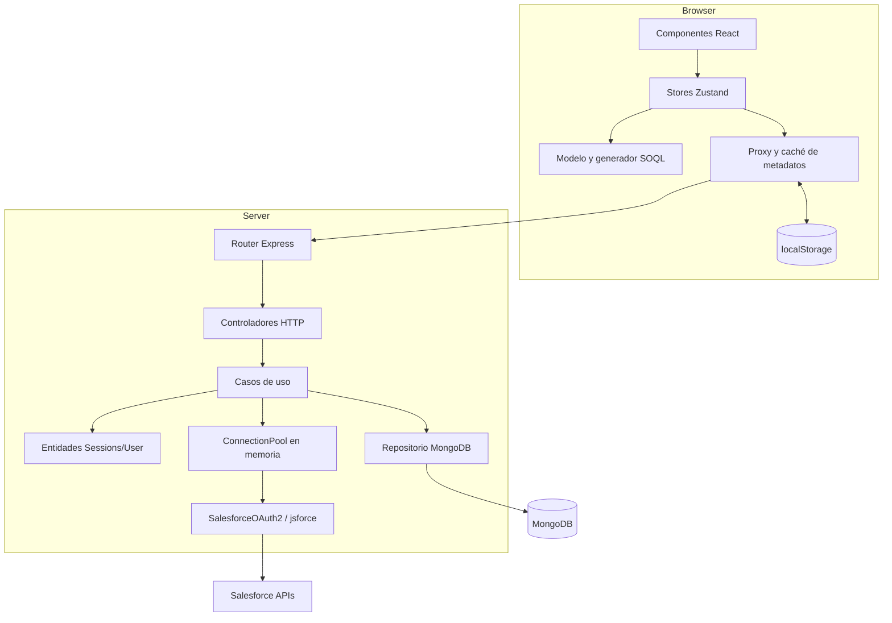
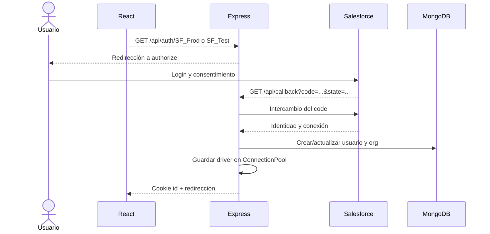
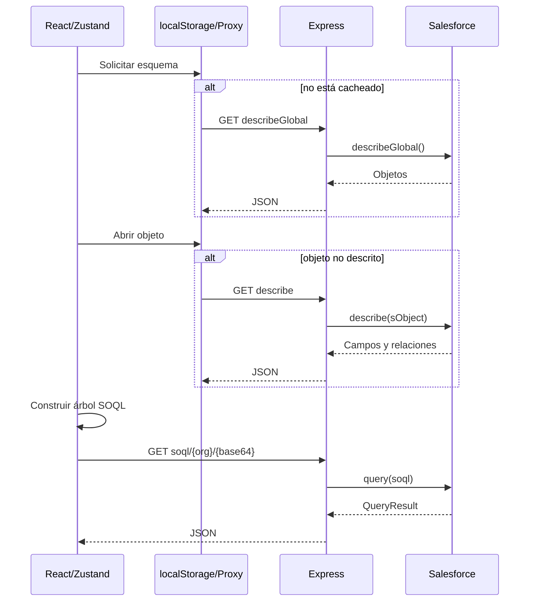

# Arquitectura de SF Studio

## 1. Vista general

El repositorio es un monorepo npm:

- `api`: Node.js, Express, TypeScript, MongoDB/Mongoose, jsforce y simple-oauth2.
- `app`: React 18, Vite, Zustand e i18next.

La API sirve de backend-for-frontend. El navegador nunca se conecta directamente a Salesforce: la API realiza OAuth, mantiene la conexión y expone operaciones de lectura.

El modelo objetivo no es «una sesión = una org». Un workspace contiene varias conexiones activas, cada una con identidad estable, y permite elegir una como contexto o dos como pareja de comparación.



## 2. Backend

### Arranque y composición

- `api/src/config/environment.ts` valida y tipa la configuración antes de abrir el puerto.
- `api/src/index.ts` compone la aplicación, el router y la sonda de readiness, y escucha en `PORT`.
- `api/src/app.ts` instala JSON, cookies, health/readiness, estáticos en producción, router y 404.
- `api/src/container.ts` construye manualmente repositorios, casos de uso y controladores.

El contenedor es sencillo y suficiente para el tamaño actual. No hace falta introducir un framework de inyección.

### Capas

#### Dominio

- `Sessions` contiene un mapa en memoria de UUID de workspace a `UserEntity` y elimina entradas expiradas al consultarlas.
- `UserEntity` contiene organizaciones configuradas, conexión actual y estado abierto/cerrado.
- `configuredConnections` envuelve la configuración de una organización.
- `SessionDTO` devuelve al cliente una vista pública codificada en Base64 que no contiene el identificador de sesión.

#### Aplicación

- `SignInUseCase` reconstruye una sesión desde memoria o MongoDB.
- `RequestConnectionUseCase` inicia OAuth para una conexión nueva o conocida.
- `RequestedConnectionUseCase` procesa el callback, persiste la organización y registra el driver activo.
- `SignOutUseCase` debería cerrar la sesión, pero actualmente `UserEntity.signOut()` no está implementado.
- `MetadataRequestUseCase` delega describe y SOQL en el driver activo.

#### Adaptadores

- Entrada: router y controladores Express.
- Salida: `MongoDBUserRepository`, `ConnectionPool` y `SalesforceOAuth2`.
- `ConnectionDriverFactory` anticipa MongoDB, MySQL y PostgreSQL, pero lanza «not implemented» para ellos.

### Datos persistidos

La colección `User` contiene:

- nombre y fecha de creación;
- conexiones con tecnología, usuario Salesforce, organización, URL de instancia y alias.
- una clave `sessionId` heredada, no usada para autenticación, que se conserva temporalmente para no romper el índice único existente en despliegues anteriores.

La colección `WorkspaceSession` contiene únicamente:

- identificador de workspace UUID generado con `crypto.randomUUID`;
- referencia al usuario propietario;
- fecha `expiresAt`, usada también como índice TTL de MongoDB.

No se persiste el access token. Esto reduce el impacto de una fuga de MongoDB, pero obliga a reautenticar tras reinicios o cuando la conexión desaparece del pool.

La cookie `sfstudio_workspace` contiene únicamente el UUID opaco. Es `HttpOnly`, `SameSite=Lax`, usa `Path=/`, expira a las ocho horas y añade `Secure` en producción. El identificador se rota después de completar OAuth; la rotación actualiza memoria, MongoDB y el pool de conexiones, por lo que el valor anterior deja de ser válido.

## 3. Frontend

### Stores Zustand

| Store | Responsabilidad |
| --- | --- |
| `sessionState` | Sesión pública, organizaciones y acciones de login/logout. |
| `dataState` | Objetos, campos, relaciones, filtros y comandos dinámicos. |
| `modelState` | Árbol SOQL, selección de campos, WHERE y generación del texto. |
| `sqlExecutionState` | Ejecutar SOQL y convertir la respuesta a tabla. |
| `viewState` | Vista activa, componentes auxiliares y pila de diálogos. |
| `applicationState` | Consola de comandos, contexto, sugerencias y errores. |

`applicationHook` coordina los stores. Es el orquestador de la experiencia: reacciona a cambios de sesión, filtros y comandos.

### Caché y adaptación del esquema

`services/salesforceSchema/proxy.ts` mantiene un mapa en memoria por organización:

- carga `describeGlobal`;
- numera objetos y construye índices por nombre;
- carga `describe(sObject)` solo cuando hace falta;
- numera campos y resuelve relaciones a índices locales;
- filtra objetos y campos;
- expone un `ModelReader` de solo lectura.

`controller.ts` añade una segunda caché en `localStorage`, indexada por URL.

### Modelo SOQL

El modelo representa:

- consulta raíz;
- subconsultas de relaciones hijas;
- recorridos de relaciones padre;
- selección individual o `FIELDS(ALL/CUSTOM/STANDARD)`;
- funciones agregadas y `GROUP BY`;
- condiciones `WHERE`;
- `LIMIT`.

Después recorre esta estructura y produce el texto SOQL. La dirección es buena: el siguiente paso debería ser extraer esta lógica a un módulo puro con pruebas exhaustivas.

### Interfaz

La página principal combina:

- gestor de conexiones;
- ruta de la consulta;
- consola de comandos y menús;
- panel de objetos;
- panel de campos/relaciones;
- diálogo de selección y filtros;
- tabla de resultados.

La consola funciona como una «command palette» contextual. Los comandos se registran al inicializar cada store y algunos se generan dinámicamente a partir del esquema.

## 4. API HTTP actual

| Método y ruta | Uso |
| --- | --- |
| `GET /health` | Liveness del proceso, independiente de MongoDB y Salesforce. |
| `GET /ready` | Readiness basada en el estado de la conexión MongoDB. |
| `GET /api/init` | Recuperar la sesión pública o indicar sesión nueva. |
| `GET /api/auth/:tech` | Iniciar OAuth para producción o sandbox. |
| `GET /api/connections/:connectionId` | Reautenticar una organización conocida. |
| `GET /api/callback` | Procesar el callback de Salesforce. |
| `GET /api/logout/:dbName` | Cerrar sesión; hoy es incompleto. |
| `GET /api/describeGlobal/:dbName` | Obtener objetos de la organización. |
| `GET /api/describe/:dbName/:sobject` | Obtener campos y relaciones. |
| `GET /api/soql/:dbName/:soql` | Ejecutar SOQL codificado en Base64 URL-safe. |

El frontend también intenta llamar a `GET /api/getObjectmetadata/:dbName/:sobject`, pero esa ruta no existe en el router.

## 5. Flujos

### OAuth y creación de sesión



### Exploración y consulta



## 6. Límites arquitectónicos actuales

- Las sesiones y conexiones activas no son compartidas entre instancias.
- Un reinicio del proceso invalida el pool aunque MongoDB conserve la organización.
- La caché del navegador no tiene TTL ni versión de esquema.
- Los tipos globales `.d.ts` acoplan muchas áreas del frontend.
- El generador SOQL, los comandos y la navegación se coordinan mediante cadenas, lo que dificulta refactorizar.
- La API mezcla respuestas JSON serializadas como `string` con objetos JSON normales.

## 7. Evolución necesaria para multi-org

La implementación ya contiene un mapa de conexiones por sesión, pero el frontend y parte del dominio siguen suponiendo una única `currentConnection`.

El modelo recomendado es:

```typescript
type OrgKey = string; // organizationId:userId

interface Workspace {
  id: string;
  activeOrgKey: OrgKey | null;
  connections: Map<OrgKey, OrgConnection>;
  comparison: {
    sourceOrgKey: OrgKey;
    targetOrgKey: OrgKey;
  } | null;
}
```

Cada caché debe incluir `OrgKey` y versión de API. El alias y el hostname sirven para presentación, no como identidad.

El motor de comparación debería recibir dos snapshots normalizados y devolver un diff puro. No debe llamar directamente a React, Zustand, MongoDB ni Salesforce; así será fácil probarlo y reutilizarlo desde ratón o comando.
