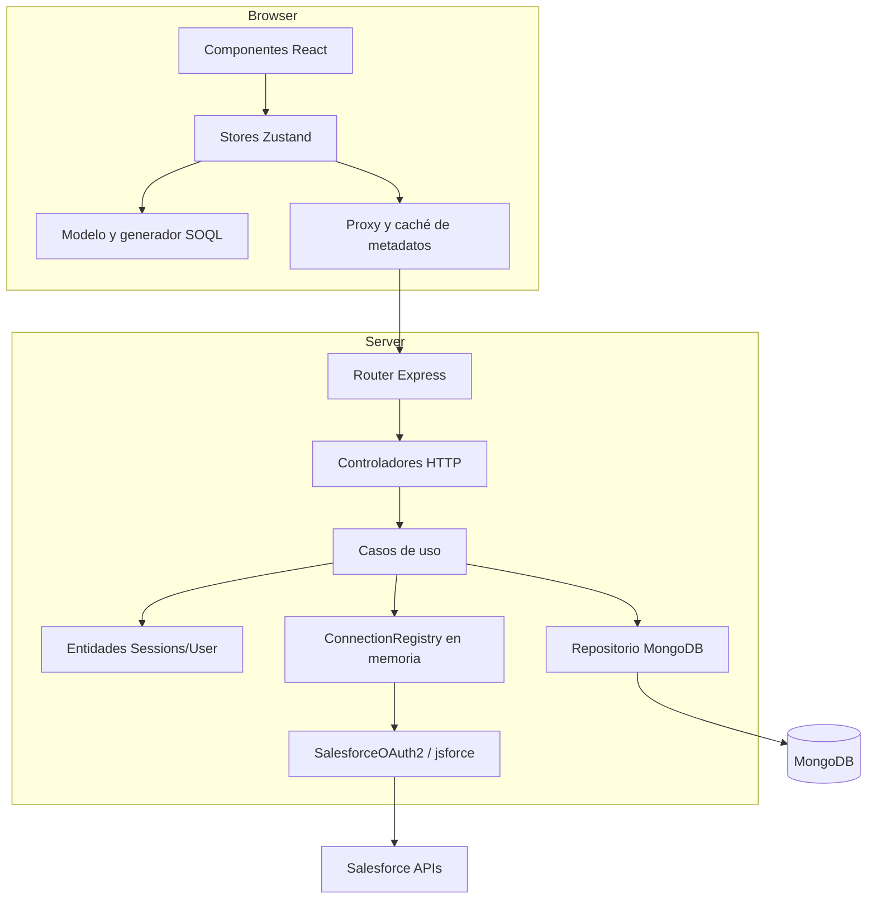
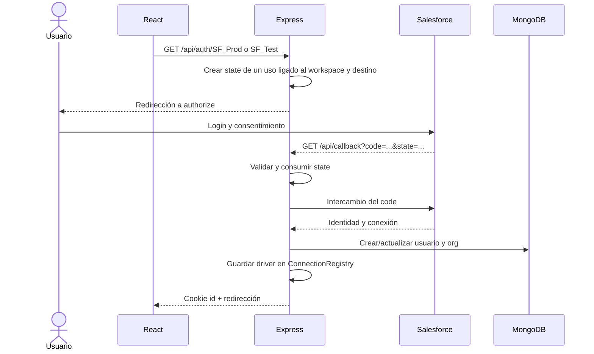
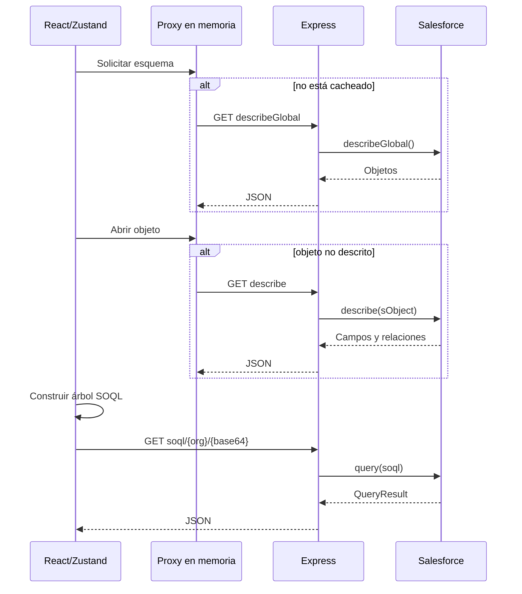

# Arquitectura de SF Studio

## 1. Vista general

El repositorio es un monorepo npm:

- `api`: Node.js, Express, TypeScript, MongoDB/Mongoose, jsforce y simple-oauth2.
- `app`: React 18, Vite, Zustand e i18next.

La API sirve de backend-for-frontend. El navegador nunca se conecta directamente a Salesforce: la API realiza OAuth, mantiene la conexión y expone operaciones de lectura.

El modelo objetivo no es «una sesión = una org». Un workspace contiene varias conexiones activas, cada una con identidad estable, y permite elegir una como contexto o dos como pareja de comparación.



## 2. Backend

### Arranque y composición

- `api/src/config/environment.ts` valida y tipa la configuración antes de abrir el puerto.
- `api/src/index.ts` compone la aplicación, el router y la sonda de readiness, y escucha en `PORT`.
- `api/src/app.ts` instala JSON, cookies, health/readiness, estáticos en producción, router y 404.
- `api/src/container.ts` construye manualmente repositorios, casos de uso y controladores.

El contenedor es sencillo y suficiente para el tamaño actual. No hace falta introducir un framework de inyección.

### Capas

#### Dominio

- `Sessions` contiene un mapa en memoria de UUID de workspace a `UserEntity` y elimina entradas expiradas al consultarlas.
- `UserEntity` contiene organizaciones configuradas, `activeOrgKey` y estados de conexión por `OrgKey`.
- `configuredConnections` envuelve la configuración de una organización y obtiene su `OrgKey` de los IDs Salesforce.
- `SessionDTO` devuelve la vista pública JSON versionada; `/api/init` conserva temporalmente la representación Base64 sin identificador de sesión.

#### Aplicación

- `SignInUseCase` reconstruye una sesión desde memoria o MongoDB.
- `RequestConnectionUseCase` inicia OAuth para una conexión nueva o conocida.
- `RequestedConnectionUseCase` procesa el callback, persiste la organización y registra el driver activo.
- `SignOutUseCase` debería cerrar la sesión, pero actualmente `UserEntity.signOut()` no está implementado.
- `MetadataRequestUseCase` delega describe y SOQL en el driver activo.

#### Adaptadores

- Entrada: router y controladores Express.
- Salida: `MongoDBUserRepository`, `ConnectionRegistry` y `SalesforceOAuth2`.
- `ConnectionDriverFactory` anticipa MongoDB, MySQL y PostgreSQL, pero lanza «not implemented» para ellos.

### Datos persistidos

La colección `User` contiene:

- nombre y fecha de creación;
- conexiones con tecnología, usuario Salesforce, organización, URL de instancia y alias.
- una clave `sessionId` heredada, no usada para autenticación, que se conserva temporalmente para no romper el índice único existente en despliegues anteriores.

La colección `WorkspaceSession` contiene únicamente:

- identificador de workspace UUID generado con `crypto.randomUUID`;
- referencia al usuario propietario;
- fecha `expiresAt`, usada también como índice TTL de MongoDB.

No se persiste el access token. Esto reduce el impacto de una fuga de MongoDB, pero obliga a reautenticar tras reinicios o cuando una conexión desaparece del registro en memoria.

La cookie `sfstudio_workspace` contiene únicamente el UUID opaco. Es `HttpOnly`, `SameSite=Lax`, usa `Path=/`, expira a las ocho horas y añade `Secure` en producción. El identificador se rota después de completar OAuth; la rotación actualiza memoria, MongoDB y el registro de conexiones, por lo que el valor anterior deja de ser válido.

Los intentos OAuth se guardan temporalmente en `OAuthStateStore`. Cada `state` contiene 256 bits aleatorios y queda asociado en el servidor al workspace (o a un UUID temporal durante el primer login), al destino, a un `correlationId` y a una expiración de diez minutos. El callback lee `state` desde la query, comprueba su asociación y lo consume antes de intercambiar el `code` con Salesforce. Por tanto, un valor ausente, expirado, repetido o perteneciente a otro workspace no llega al driver externo.

El destino validado incluye `loginHost`: `login.salesforce.com` para producción o `test.salesforce.com` para sandbox. El mismo host se usa en la autorización y el intercambio; `instanceUrl` solo describe la instancia recibida después del login. Connected Apps y External Client Apps comparten el flujo Web Server Flow con `CLIENT_ID`, `CLIENT_SECRET` y callback configurados en la API. El adapter OAuth traduce fallos del proveedor a `SALESFORCE_AUTH_FAILED` sin copiar sus mensajes a respuestas o logs.

El store OAuth vive en memoria y no contiene tokens. Un reinicio o el uso de varias instancias invalida los intentos pendientes; el usuario debe iniciar de nuevo el login. Esta limitación es aceptada para la primera fase y deberá resolverse con un almacén temporal compartido antes de escalar horizontalmente.

La API emite logs JSON mediante un logger estructurado. Cada petición obtiene un `correlationId`, que también se devuelve en `X-Correlation-Id` y en los errores. El logger redacta cookies, códigos OAuth, `state`, tokens, secretos, URLs de autorización e identificadores personales sensibles.

## 3. Frontend

### Stores Zustand

| Store | Responsabilidad |
| --- | --- |
| `sessionState` | Sesión pública, organizaciones y acciones de login/logout. |
| `dataState` | Objetos, campos, relaciones, filtros y comandos dinámicos. |
| `modelState` | Árbol SOQL, selección de campos, WHERE y generación del texto. |
| `sqlExecutionState` | Ejecutar SOQL y convertir la respuesta a tabla. |
| `viewState` | Vista activa, componentes auxiliares y pila de diálogos. |
| `applicationState` | Consola de comandos, contexto, sugerencias y errores. |

`applicationHook` coordina los stores. Es el orquestador de la experiencia: reacciona a cambios de sesión, filtros y comandos.

### Caché y adaptación del esquema

`services/salesforceSchema/proxy.ts` mantiene un mapa en memoria por organización:

- carga `describeGlobal`;
- numera objetos y construye índices por nombre;
- carga `describe(sObject)` solo cuando hace falta;
- numera campos y resuelve relaciones a índices locales;
- filtra objetos y campos;
- expone un `ModelReader` de solo lectura.

El cliente HTTP compartido usa `/api/v1` relativo por defecto y conserva `code` y `correlationId` de los errores públicos. Metadata y SOQL usan temporalmente las rutas `/api` heredadas a través de ese mismo cliente. La caché de esquema sigue solo en memoria; no se copian respuestas Salesforce a `localStorage`.

### Modelo SOQL

El modelo representa:

- consulta raíz;
- subconsultas de relaciones hijas;
- recorridos de relaciones padre;
- selección individual o `FIELDS(ALL/CUSTOM/STANDARD)`;
- funciones agregadas y `GROUP BY`;
- condiciones `WHERE`;
- `LIMIT`.

Después recorre esta estructura y produce el texto SOQL. La dirección es buena: el siguiente paso debería ser extraer esta lógica a un módulo puro con pruebas exhaustivas.

### Interfaz

La página principal combina:

- gestor de conexiones;
- ruta de la consulta;
- consola de comandos y menús;
- panel de objetos;
- panel de campos/relaciones;
- diálogo de selección y filtros;
- tabla de resultados.

La consola funciona como una «command palette» contextual. Los comandos se registran al inicializar cada store y algunos se generan dinámicamente a partir del esquema.

## 4. API HTTP actual

### Contrato multi-org v1

`GET /api/v1/workspace` devuelve JSON tipado, versión 1, con una lista de conexiones conocidas y `activeOrgKey`. `OrgKey` concatena `organizationId:userId`; alias y hostname nunca identifican una conexión. Cada conexión expone identidad, alias, URL de instancia, host de login, entorno y estado. La ruta `GET /api/v1/connections/:orgKey/authorize` reautentica una org conocida del workspace. El callback comprueba la identidad devuelta por Salesforce antes de asociar el driver al workspace. `ConnectionRegistry` guarda `Map<WorkspaceId, Map<OrgKey, driver>>` en memoria. La API reconcilia sus claves con las orgs conocidas para mostrar `CONNECTED` o `REAUTH_REQUIRED`; nunca serializa el driver ni sus tokens.

La expiración de cada workspace se comprueba al acceder al registro y mediante una limpieza periódica de un minuto. Al expirar o sustituir una conexión se llama a `dispose()` para soltar la referencia a jsforce. Al desconectar se intenta revocar el access token con Salesforce y se elimina el driver aunque la revocación remota falle. La rotación de sesión tras OAuth mueve todas las conexiones del workspace al nuevo ID. Una org conocida sin driver, o con token Salesforce expirado, devuelve `401 REAUTH_REQUIRED` en los endpoints de lectura; el cliente actualiza el workspace para mostrar la acción de reautenticación.

`DELETE /api/v1/workspace/orgs/:orgKey` es idempotente para una org conocida: devuelve el contrato público del workspace con esa org en `REAUTH_REQUIRED`, sin afectar las otras. Una identidad desconocida devuelve `404 ORG_NOT_FOUND`, y una clave mal formada `400 ORG_KEY_INVALID`. `DELETE /api/v1/workspace` elimina los drivers y el documento de sesión `WorkspaceSession`, revoca los tokens disponibles y expira la cookie; responde `204`. Se conservan únicamente las identidades no secretas de las orgs conocidas en `User` para una futura reconexión explícita.

La colección `WorkspaceSession` admite varias sesiones del mismo usuario. Al crear la primera sesión tras actualizar, el repositorio elimina únicamente el índice único heredado `user_1` si sigue presente; mantiene intactos `sessionId_1` y el TTL. La aplicación no almacena conexiones activas en MongoDB.

Los documentos `User.connections` antiguos se normalizan al leerlos: se conserva una entrada solo si tiene ambos IDs Salesforce válidos. Se añade `contractVersion: 1` y el host de login; entradas sin identidad o duplicadas se descartan y requieren nueva conexión. El identificador heredado `dbName` se conserva únicamente en MongoDB por compatibilidad del documento. No se usa como clave de sesión o conexión.

`/api/init` sigue disponible temporalmente para compatibilidad, con el mismo contenido público codificado en Base64. El frontend usa el JSON de `/api/v1/workspace`.

| Método y ruta | Uso |
| --- | --- |
| `GET /health` | Liveness del proceso, independiente de MongoDB y Salesforce. |
| `GET /ready` | Readiness basada en el estado de la conexión MongoDB. |
| `GET /api/init` | Recuperar la sesión pública o indicar sesión nueva. |
| `GET /api/auth/:tech` | Iniciar OAuth para producción o sandbox. |
| `GET /api/v1/workspace` | Obtener contrato público JSON versionado del workspace. |
| `GET /api/v1/connections/:orgKey/authorize` | Reautenticar una organización conocida del workspace. |
| `GET /api/callback` | Procesar el callback de Salesforce. |
| `DELETE /api/v1/workspace/orgs/:orgKey` | Desconectar una org conocida; devuelve el workspace actualizado. |
| `DELETE /api/v1/workspace` | Cerrar todo el workspace, borrar la sesión y expirar la cookie. |
| `GET /api/describeGlobal/:orgKey` | Obtener objetos de la organización. |
| `GET /api/describe/:orgKey/:sobject` | Obtener campos y relaciones. |
| `GET /api/soql/:orgKey/:soql` | Ejecutar SOQL codificado en Base64 URL-safe; pendiente de sustitución por POST en Sprint 05. |

El frontend también intenta llamar a `GET /api/getObjectmetadata/:dbName/:sobject`, pero esa ruta no existe en el router.

## 5. Flujos

### OAuth y creación de sesión



### Exploración y consulta



## 6. Límites arquitectónicos actuales

- Las sesiones y conexiones activas no son compartidas entre instancias.
- Los intentos OAuth pendientes viven en memoria; un reinicio o cambio de instancia obliga a reiniciar el login.
- Un reinicio del proceso invalida el registro en memoria aunque MongoDB conserve la organización.
- La caché del navegador no tiene TTL ni versión de esquema.
- Los tipos globales `.d.ts` acoplan muchas áreas del frontend.
- El generador SOQL, los comandos y la navegación se coordinan mediante cadenas, lo que dificulta refactorizar.
- La API mezcla respuestas JSON serializadas como `string` con objetos JSON normales.

## 7. Evolución necesaria para multi-org

El dominio y el frontend usan `OrgKey` para la org activa; el pool puede contener varias conexiones en el mismo workspace. La selección visual completa de orgs se aborda en Sprint 03.

El modelo recomendado es:

```typescript
type OrgKey = string; // organizationId:userId

interface Workspace {
  id: string;
  activeOrgKey: OrgKey | null;
  connections: Map<OrgKey, OrgConnection>;
  comparison: {
    sourceOrgKey: OrgKey;
    targetOrgKey: OrgKey;
  } | null;
}
```

Cada caché debe incluir `OrgKey` y versión de API. El alias y el hostname sirven para presentación, no como identidad.

El motor de comparación debería recibir dos snapshots normalizados y devolver un diff puro. No debe llamar directamente a React, Zustand, MongoDB ni Salesforce; así será fácil probarlo y reutilizarlo desde ratón o comando.
