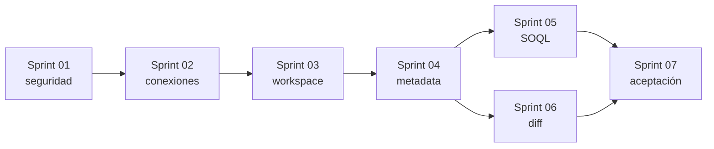

# Plan de sprints de la primera fase

## Propósito

Este plan convierte los criterios de éxito de [VISION_PRODUCTO.md](./VISION_PRODUCTO.md) en siete incrementos ordenados por dependencia. Los sprints no tienen una duración impuesta: antes de comenzar cada uno, el equipo debe ajustar alcance y capacidad sin partir una PBI entre sprints salvo decisión explícita.

## Resumen

| Sprint | Resultado |
| --- | --- |
| [Sprint 01](./sprint01/guia%20del%20sprint.md) | Base reproducible, configuración validada, sesión segura y OAuth state. |
| [Sprint 02](./sprint02/guia%20del%20sprint.md) | Varias conexiones por workspace, producción/sandbox y reautenticación. |
| [Sprint 03](./sprint03/guia%20del%20sprint.md) | Selector multi-org y dispatcher común para ratón/comandos. |
| [Sprint 04](./sprint04/guia%20del%20sprint.md) | Metadata normalizada, IndexedDB e exploración aislada por org. |
| [Sprint 05](./sprint05/guia%20del%20sprint.md) | SOQL seguro, destino explícito, límites, paginación y resultados efímeros. |
| [Sprint 06](./sprint06/guia%20del%20sprint.md) | Motor puro de comparación de objetos, campos, picklists y relaciones. |
| [Sprint 07](./sprint07/guia%20del%20sprint.md) | Experiencia de comparación, comandos y aceptación integral. |

## Trazabilidad con los criterios de éxito

| Criterio de `VISION_PRODUCTO.md` | PBIs que lo construyen | Evidencia final |
| --- | --- | --- |
| Conectar al menos dos orgs en el mismo workspace | PBI-005, 006, 007, 012 | E2E multi-org y aceptación PBI-028 |
| Alternar sin confundir contexto | PBI-009, 010, 011, 012 | Selector, etiqueta de destino y E2E |
| Explorar y consultar cualquiera en solo lectura | PBI-013 a 020 | E2E explorer/query y rechazo de no-SELECT |
| Comparar Integración y UAT por objeto, campo y relación | PBI-021 a 026 | Golden tests del diff y E2E comparación |
| Acción importante con ratón y comando gemelo | PBI-011, 015, 020, 027 | Matriz de paridad y E2E solo teclado |
| Reinicio/expiración con reautenticación clara | PBI-007, 008, 025 | Prueba de registro vacío + estado REAUTH_REQUIRED |
| No guardar tokens ni datos de negocio en MongoDB | PBI-003, 004, 007, 014, 020, 028 | Inspección automatizada de DB, stores y logs |
| Consultas limitadas y resultados no persistidos | PBI-018, 019, 020 | Tests de límite/paginación y persistencia |

## Dependencias principales

Sprint 05 y Sprint 06 podrían desarrollarse en paralelo después de Sprint 04 si el equipo tiene capacidad independiente, pero ambos deben terminar antes de la aceptación del Sprint 07.

## Reglas de planificación

- Todas las PBIs están marcadas Must porque componen la primera fase acordada.
- El tamaño S/M/L es relativo; debe recalibrarse con el equipo.
- Una PBI entra en sprint solo si sus dependencias están terminadas.
- Todo cambio funcional requiere prueba; los flujos OAuth reales añaden una comprobación manual controlada.
- No se aceptan tokens o datos reales en fixtures.
- Cualquier acción visual nueva debe registrar su comando gemelo en la misma PBI.
- La extensión de navegador es un épico posterior y no condiciona esta fase.

## Release de primera fase

No se considera terminada al completar código individual. La salida se produce cuando PBI-028 demuestra conjuntamente los ocho criterios, el runbook de Render está actualizado y no quedan defectos bloqueantes ni riesgos de seguridad aceptados implícitamente.
