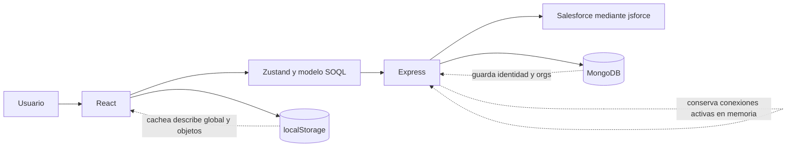

# SF Studio: guía para retomar el proyecto

Revisión realizada el 25 de octubre de 2026.

## Qué es el proyecto

SF Studio es una herramienta interna para explorar varias organizaciones de Salesforce, construir consultas SOQL y comparar entornos de un mismo proyecto sin tener que recordar toda la sintaxis ni los nombres API.

El producto actual permite:

- iniciar sesión en Salesforce mediante OAuth;
- recordar las organizaciones asociadas a un usuario;
- descargar el catálogo de objetos de una organización;
- explorar campos y relaciones padre/hijo;
- filtrar objetos y campos por sus propiedades;
- construir consultas SOQL seleccionando campos, filtros, funciones agregadas y subconsultas;
- ejecutar la consulta mediante la API;
- mostrar los resultados tabularmente;
- manejar parte de la interfaz mediante comandos y menús contextuales.

El objetivo original era «administrar los datos de una org de Salesforce». La definición actual es más precisa: un **workspace multi-org y de solo lectura en la primera fase**, pensado especialmente para comparar, por ejemplo, Integración y UAT. El estado actual cubre parte de la exploración del esquema y la consulta, pero la comparación todavía no está implementada.

## Mapa de la documentación

- [ARQUITECTURA.md](./ARQUITECTURA.md): componentes, datos, flujos y decisiones técnicas.
- [VISION_PRODUCTO.md](./VISION_PRODUCTO.md): alcance, multi-org, comparación, comandos y decisión sobre tokens.
- [GUIA_DESARROLLO.md](./GUIA_DESARROLLO.md): instalación, variables, comandos, Render y diagnóstico.
- [EVALUACION_Y_HOJA_DE_RUTA.md](./EVALUACION_Y_HOJA_DE_RUTA.md): crítica constructiva, riesgos y plan recomendado.
- [PLAN_DE_SPRINTS.md](./PLAN_DE_SPRINTS.md): siete sprints, 28 PBIs y trazabilidad con los criterios de éxito.

## Mapa rápido del repositorio

| Ruta | Responsabilidad |
| --- | --- |
| `package.json` | Monorepo npm; coordina los workspaces `api` y `app`. |
| `api/` | Servidor Express en TypeScript, OAuth de Salesforce y persistencia MongoDB. |
| `api/src/sessionManager/domain` | Entidades y puertos del dominio de sesión/conexión. |
| `api/src/sessionManager/application` | Casos de uso y DTO. |
| `api/src/sessionManager/infrastructure` | HTTP, MongoDB, jsforce y pool de conexiones. |
| `app/` | SPA React/Vite. |
| `app/src/store` | Estado Zustand de sesión, datos, modelo SOQL, vista y ejecución. |
| `app/src/services` | Acceso a la API, caché del esquema y adaptación de metadatos. |
| `app/src/components` | Interfaz por componentes atómicos y organismos. |
| `app/src/core` | Registro de comandos, tipos de campo y reglas para construir SOQL. |

## Modelo mental en un minuto

Hay cuatro estados distintos:

1. **MongoDB** guarda usuarios y organizaciones configuradas, pero no el token de Salesforce.
2. **Memoria del servidor** guarda sesiones y conexiones `jsforce` activas.
3. **localStorage** guarda respuestas de descripción del esquema.
4. **Zustand** guarda el estado temporal de la interfaz y el árbol de la consulta SOQL.

Esta separación explica varios comportamientos actuales: reiniciar el servidor pierde las conexiones activas, pero no la lista de organizaciones; limpiar el navegador elimina la caché de metadatos; recargar la página reconstruye el estado de UI.

## Recorrido principal

1. La SPA llama a `GET /api/init`.
2. Si no hay cookie, presenta una sesión nueva.
3. El usuario elige producción o sandbox.
4. La API redirige al OAuth de Salesforce.
5. Salesforce vuelve a `/api/callback`.
6. La API crea una conexión `jsforce`, identifica usuario y organización, guarda la configuración en MongoDB y deja la conexión viva en el pool en memoria.
7. La SPA solicita `describeGlobal` y muestra los objetos.
8. Al abrir un objeto, solicita `describe` de forma perezosa.
9. El usuario compone una consulta en el modelo SOQL.
10. La SPA envía la consulta codificada a la API, que la ejecuta con `jsforce`.

## Estado comprobado

| Comprobación | Resultado |
| --- | --- |
| TypeScript de la API | Correcto |
| Build React/Vite | Correcto; bundle JS aproximado de 298 kB, 91 kB gzip |
| Lint | No ejecuta: el script usa `--ext`, incompatible con flat config |
| Pruebas | No ejecutan: `jest.e2e.setup.js` requiere `node-fetch` y no está instalado |
| Seguridad npm | 4 avisos: 1 alto y 3 moderados, todos alrededor del Vite de desarrollo |
| Cobertura útil | Prácticamente inexistente; los dos tests actuales son esqueletos |

## Lo mejor del proyecto

- La intención del producto es clara y resuelve una fricción real de Salesforce.
- El modelo de consulta no concatena todo directamente desde la UI: mantiene una estructura de raíz, subconsultas y relaciones.
- El backend tiene una separación reconocible entre dominio, casos de uso y adaptadores.
- Los drivers permiten pensar en futuras fuentes de datos, aunque hoy solo Salesforce esté implementado.
- La carga perezosa y caché del esquema evita repetir llamadas costosas.
- Los tokens de Salesforce no se guardan en MongoDB.
- TypeScript estricto está activo y tanto API como frontend compilan.

## Advertencia antes de ampliar funcionalidad

La primera iteración no debería añadir CRUD. Antes conviene estabilizar autenticación, sesiones, despliegue, pruebas y construcción de SOQL. La hoja de ruta propone un orden concreto.
