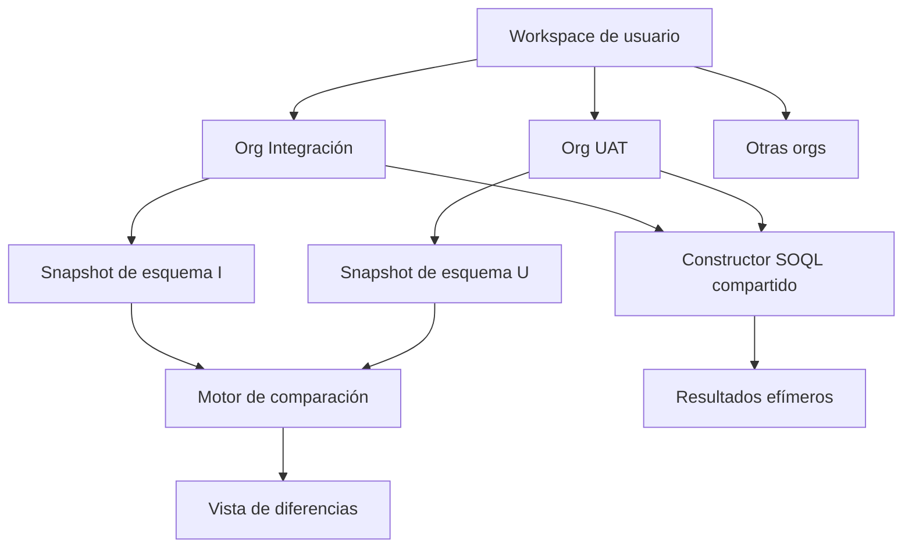

# Visión de producto

## Definición

SF Studio será una **herramienta interna, de solo lectura en su primera fase, para explorar, consultar y comparar varias organizaciones Salesforce dentro de una misma sesión de trabajo**.

Su propósito no es almacenar grandes volúmenes de información ni sustituir Salesforce. Debe hacer más comprensible y amable la gestión cotidiana de objetos, campos, relaciones y consultas.

La capacidad multi-org es parte del núcleo del producto. El caso de uso de referencia es trabajar simultáneamente con las organizaciones de Integración y UAT de un mismo proyecto y detectar sus diferencias sin cambiar continuamente de aplicación, usuario o contexto.

## Usuarios

Usuarios internos de un equipo Salesforce:

- desarrolladores;
- administradores;
- analistas técnicos;
- responsables de pruebas y despliegues.

No se plantea inicialmente como SaaS público ni como producto multiempresa.

## Principios de producto

### 1. Solo lectura primero

La primera fase permite:

- consultar metadatos;
- explorar objetos, campos y relaciones;
- construir y ejecutar SOQL;
- comparar metadatos entre organizaciones;
- exportar resultados cuando sea útil.

No permite crear, actualizar ni eliminar registros o configuración.

### 2. Varias organizaciones en un workspace

Una sesión de trabajo puede tener varias organizaciones autenticadas simultáneamente. El usuario puede:

- ver qué organizaciones están abiertas;
- saber cuál es el contexto activo;
- cambiar de organización sin repetir login mientras la conexión siga viva;
- elegir dos organizaciones para compararlas;
- ejecutar una consulta indicando explícitamente el destino;
- cerrar una conexión sin cerrar todo el workspace.

«Sesión», «workspace» y «organización conectada» no deben confundirse:

- **workspace**: contexto temporal del usuario en SF Studio;
- **conexión**: autenticación activa con una org;
- **organización configurada**: org conocida que puede requerir reautenticación;
- **organización activa**: destino actual de navegación o consulta.

### 3. Ratón y comandos equivalentes

Toda acción funcional disponible mediante ratón debe tener un comando gemelo. Ambas entradas deben invocar el mismo caso de uso, no mantener implementaciones paralelas.

Ejemplos:

| Acción visual | Comando conceptual |
| --- | --- |
| Abrir organización | `org open <alias>` |
| Cambiar organización activa | `org use <alias>` |
| Comparar dos organizaciones | `org compare <origen> <destino>` |
| Abrir objeto | `object open Account` |
| Filtrar campos | `field filter custom on` |
| Ejecutar consulta | `query run` |
| Cerrar conexión | `org close <alias>` |

El registro central de comandos ya existente es una buena base. La UI debería emitir identificadores de acción y parámetros hacia el mismo dispatcher usado por la consola.

### 4. Producción y sandbox tienen las mismas capacidades

No habrá diferencias funcionales entre producción y sandbox: navegación, consulta y comparación funcionan igual.

Sí debe conservarse y mostrarse la identidad real del entorno para evitar errores humanos:

- tipo de instancia;
- alias;
- organization ID;
- usuario conectado;
- color o etiqueta no ambigua.

Esto no introduce distintas funciones, solo contexto y seguridad visual.

### 5. No es un data lake

SF Studio procesa resultados bajo demanda. No debe replicar ni conservar datasets completos.

En la primera fase:

- los metadatos pueden cachearse con versión y expiración;
- los resultados de consulta permanecen en memoria o se descargan a petición;
- no se indexan registros de Salesforce en MongoDB;
- se establecen límites y paginación;
- la comparación inicial es de **estructura y metadatos**, no de todos los registros.

## Caso de uso principal: comparar Integración y UAT

### Flujo esperado

1. El usuario abre su workspace.
2. Autentica la org de Integración.
3. Autentica la org de UAT.
4. Selecciona ambas en «Comparar».
5. SF Studio descarga o reutiliza el snapshot vigente de metadatos.
6. La aplicación muestra diferencias navegables.
7. El usuario abre un objeto para ver diferencias de campos y relaciones.
8. Puede saltar desde una diferencia al explorador de cualquiera de las orgs.

### Primera versión de la comparación

Comparar:

- objetos presentes solo en una org;
- propiedades relevantes del objeto;
- campos presentes solo en una org;
- tipo, longitud, precisión, escala y obligatoriedad;
- valores de picklist;
- relaciones y nombres de relación;
- capacidad `queryable/createable/updateable/deletable` como información, aunque la app siga siendo de solo lectura.

Fuera de la primera versión:

- comparación exhaustiva de registros;
- sincronización automática;
- despliegue de metadata;
- diferencias de Apex, Flows, layouts o permisos completos;
- escritura para «igualar» una org con otra.

### Identidad técnica

No se debe identificar una organización por el nombre derivado de `instanceUrl`. Dos entornos podrían compartir nombres o cambiar de hostname.

Clave recomendada:

```text
organizationId + ":" + userId
```

La UI puede mostrar un alias editable, pero las cachés, conexiones y comparaciones deben usar una clave estable.

## Decisión sobre refresh tokens

### Primera fase

**No persistir refresh tokens.**

Durante una sesión:

- cada OAuth crea una conexión activa;
- varias conexiones viven simultáneamente en el workspace;
- un reinicio o expiración exige reautenticar esa organización;
- la lista de organizaciones conocidas puede seguir en MongoDB sin credenciales.

Esta decisión reduce mucho el riesgo y es compatible con una herramienta interna de solo lectura. La aplicación debe detectar la pérdida de conexión y responder `REAUTH_REQUIRED`, no con un error genérico.

### Revisión futura

Solo plantear persistencia si la reautenticación frecuente perjudica claramente el trabajo. En ese caso:

- consentimiento explícito «recordar conexión»;
- cifrado por sobre con un KMS o gestor de secretos, no una clave fija dentro del repositorio;
- refresh token nunca enviado al navegador ni registrado;
- rotación de claves;
- revocación en Salesforce al desconectar;
- borrado inmediato desde la aplicación;
- auditoría de quién conectó y revocó;
- política de expiración definida por el equipo.

## Modelo funcional objetivo



## Criterios de éxito de la primera fase

- El usuario conecta al menos dos orgs en el mismo workspace.
- Puede alternar entre ellas sin confundir el contexto.
- Puede explorar objetos y ejecutar consultas de solo lectura en cualquiera.
- Puede comparar Integración y UAT a nivel de objeto, campo y relación.
- Toda acción importante tiene botón/menú y comando equivalente.
- Reinicios y expiraciones producen una solicitud clara de reautenticación.
- No se guardan tokens ni datos de negocio en MongoDB.
- Las consultas tienen límites y el resultado no se conserva automáticamente.

## No objetivos de la primera fase

- SaaS multiempresa.
- Escritura sobre registros.
- Despliegue de metadata.
- Sincronización entre organizaciones.
- Copia masiva de datos.
- Data lake o reporting histórico.
